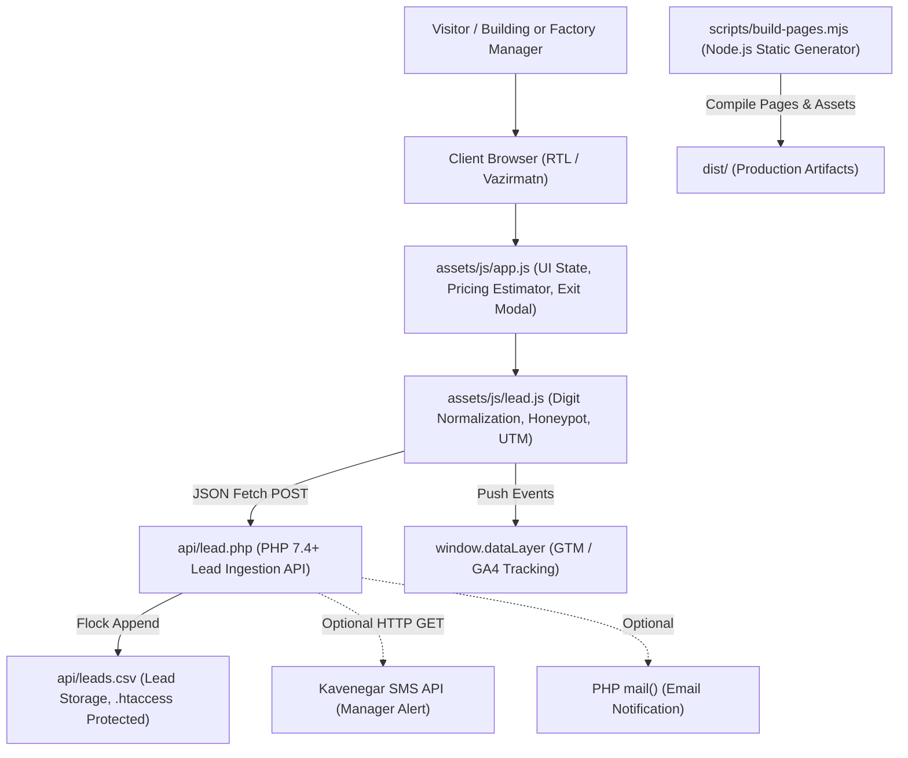

# Architecture Reference

## Overview
Marketing and lead-generation platform for **دیدبان امین توانا** (Security, Physical Guarding, and Residential/Commercial Lobby-Man Services under Police Regulation Article 122).

## System Architecture

## Runtime Data Flow
1. **User Interaction**:
   - `assets/js/app.js` manages local reactive state (`state.estimator`, persona selection, 1405 wage model calculator, exit-intent popup, and mobile drawer).
2. **Analytics & Instrumentation**:
   - `assets/js/lead.js` initialises `window.dataLayer` and registers tracking:
     - `click_call` (direct phone dials)
     - `click_whatsapp` (WhatsApp chat initiations)
     - `generate_lead_estimator` (pricing calculator submissions)
     - `request_free_inspection` (technical site visit requests)
3. **Lead Dispatch**:
   - `Dideban.submitLead(payload)` extracts query UTMs (`utm_source`, `utm_campaign`, etc.), appends page path, and posts to `api/lead.php` via fetch with a 9-second `AbortController` timeout.
4. **Backend Ingestion**:
   - `api/lead.php` parses JSON, validates the anti-bot honeypot (`website` field must be blank), enforces IP rate limits (5 submissions/hour/IP), sanitizes CSV injection vectors, writes to `api/leads.csv`, and dispatches SMS/email alerts.

## Static Site Generation (`scripts/build-pages.mjs`)
- **Engine**: Pure Node.js ES Modules with zero heavy templating dependencies.
- **Workflow**:
  - Empties and regenerates `dist/`.
  - Injects canonical domain via `SITE_URL` environment variable (default: `https://YOUR-DOMAIN.ir`).
  - Generates landing pages for core services:
    - `dist/services/lobby-man-residential-towers/index.html`
    - `dist/services/industrial-plant-security/index.html`
    - `dist/services/construction-site-guarding/index.html`
  - Generates XML sitemap (`dist/sitemap.xml`) and search directives (`dist/robots.txt`).
  - Mirrors core assets (`assets/`, `config.js`, `index.html`, `api/`).

## Directory Boundaries & Roles
| Directory / File | Role | Modifiable in Development? |
| :--- | :--- | :--- |
| `index.html` | Root landing page with interactive shift estimator | Yes |
| `config.js` | Single source of truth for runtime variables (phone, WA, GTM, reviews) | Yes |
| `src/input.css` | Tailwind directives and base styling | Yes |
| `tailwind.config.js`| Tailwind theme configuration | Yes |
| `assets/js/app.js` | UI logic, shift calculations, and modals | Yes |
| `assets/js/lead.js`| Lead dispatch, phone/WA binding, GTM events | Yes |
| `assets/css/styles.css`| Custom UI patterns (grids, watermarks, sliders) | Yes |
| `scripts/build-pages.mjs`| SSG build script | Yes |
| `api/lead.php` | Backend lead handler | Yes |
| `api/.htaccess` | Apache security barrier for CSV & logs | **Never modify/delete** |
| `assets/css/tailwind.css`| Compiled minified CSS from Tailwind CLI | **Never edit directly (Generated)** |
| `dist/` | Production build output | **Never edit directly (Generated)** |
| `single-file/` | Deprecated standalone archive | **Never edit directly (Legacy)** |
