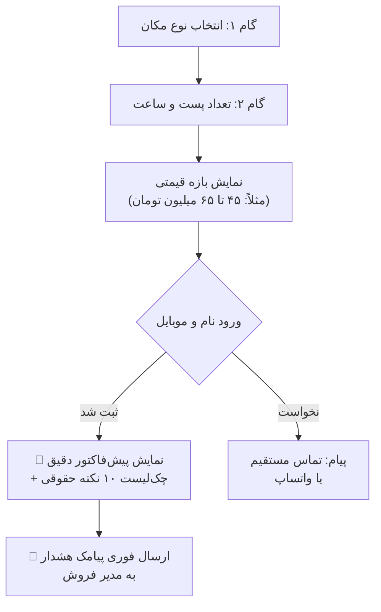

# 🛡️ برنامه جامع بهینه‌سازی نرخ تبدیل (CRO) و افزایش قراردادهای B2B
## مؤسسه مراقبتی حفاظتی دیدبان امین توانا — مجوز ماده ۱۲۲ فراجا

---

## فاز اول: کالبدشکافی اصطکاک و نشتی‌های فروش (Conversion Leak Audit)

### ۱. نقاط افت انگیزه (Friction Points) شناسایی‌شده

```mermaid
flowchart LR
    A["🔍 بازدیدکننده وارد صفحه می‌شود"] --> B{"Hero Section"}
    B -->|"❌ نشتی ۱: Persona Selector اختیاری و passive"| C["کاربر بدون شخصی‌سازی اسکرول می‌کند"]
    C --> D{"جدول مقایسه قانونی"}
    D -->|"❌ نشتی ۲: بدون CTA میانی"| E["کاربر اطلاعات می‌خواند ولی اقدامی نمی‌کند"]
    E --> F{"تب‌های خدمات"}
    F -->|"❌ نشتی ۳: ۲ تب مخفی‌اند"| G["کارخانه‌دار و سازنده فقط تب برج را می‌بینند"]
    G --> H{"برآوردگر شیفت"}
    H -->|"❌ نشتی ۴: قیمت بدون Gating"| I["مدیر قیمت را می‌بیند و بدون ثبت شماره خارج می‌شود"]
    I --> J{"اسکرول تا FAQ و فوتر"}
    J -->|"❌ نشتی ۵: بدون Exit-Intent"| K["❌ لید از دست رفته"]
```



> [!CAUTION]
> **نشتی بحرانی شماره ۱ — برآوردگر قیمت را رایگان نمایش می‌دهد:** در حال حاضر، برآوردگر شیفت مبلغ نهایی (`est-total-price`) را **بدون دریافت شماره تماس** نمایش می‌دهد. مدیر قیمت را یادداشت کرده و صفحه را ترک می‌کند. فرم Lead Magnet پایین پنل خروجی قرار دارد و اختیاری به نظر می‌رسد.

| # | نقطه نشتی | علت اصلی | تأثیر بر تبدیل | اولویت |
|---|-----------|----------|----------------|--------|
| ۱ | **برآوردگر قیمت بدون Gate** | مبلغ نهایی (`۵۴,۸۰۰,۰۰۰ تومان`) بلافاصله نمایش داده می‌شود بدون نیاز به ورود شماره | بازدیدکننده قیمت را ذخیره کرده و بدون ثبت لید خارج می‌شود | 🔴 بحرانی |
| ۲ | **عدم وجود Mobile Sticky CTA Bar** | نوار پایین موبایل (`grid-cols-2`) فقط ۲ دکمه ساده دارد، بدون واتساپ و بدون متن متقاعدکننده | حداقل ۶۵٪ ترافیک (موبایل) CTA ضعیفی می‌بیند | 🔴 بحرانی |
| ۳ | **Persona Selector تغییر صفحه نمی‌دهد** | فقط یک پاراگراف tip را عوض می‌کند، بخش‌های پایین‌تر صفحه ثابت‌اند | مدیر کارخانه محتوای خاص خود را نمی‌بیند و احساس بی‌ربطی می‌کند | 🟡 بالا |
| ۴ | **واتساپ کاملاً غیرفعال** | فیلد `whatsapp` در `config.js` خالی است، تمام دکمه‌های WA مخفی‌اند | کانال با کمترین اصطکاک برای مدیران ایرانی از دست رفته | 🔴 بحرانی |
| ۵ | **بدون Exit-Intent Modal** | هیچ مکانیزم بازیابی بازدیدکننده در حال ترک وجود ندارد | ۷۰-۸۰٪ بازدیدکنندگان بدون هیچ تعاملی خارج می‌شوند | 🟡 بالا |
| ۶ | **بدون بنر Risk-Reversal** | تضمین ۴ ساعته و عدم رابطه کارگری در متن پراکنده است اما بنر مستقل ندارد | اعتمادسازی فوری در ثانیه‌های اول ضعیف است | 🟡 بالا |
| ۷ | **جدول مقایسه بدون CTA خروجی** | ۶ ردیف ریسک خوانده می‌شود اما هیچ دکمه اقدامی در انتهای جدول نیست | کاربر متقاعدشده اما بدون مسیر تبدیل رها می‌شود | 🟠 متوسط |

### ۲. تحلیل مشکل برآوردگر شیفت (Progressive Profiling vs Gating)

**وضعیت فعلی:**
- کاربر نوع مکان، تعداد پست و ساعت را انتخاب می‌کند → مبلغ فوراً نمایش داده می‌شود
- فرم نام و موبایل در **پایین** پنل خروجی قرار دارد با عنوان «دریافت پیش‌فاکتور»
- کاربر انگیزه‌ای برای پر کردن فرم ندارد چون قیمت را قبلاً دیده

**استراتژی پیشنهادی — Smart Gating با Progressive Disclosure:**
1. **مرحله ۱ (آزاد):** انتخاب نوع مکان، تعداد پست و ساعت
2. **مرحله ۲ (آزاد):** نمایش «بازه قیمتی» به صورت مبهم (مثلاً `از ۴۵ تا ۶۵ میلیون تومان`)
3. **مرحله ۳ (Gate):** برای مشاهده «پیش‌فاکتور دقیق رسمی مهرشده + چک‌لیست ۱۰ نکته حقوقی» → ورود نام و شماره موبایل الزامی

### ۳. مشکل Hero Section و عدم تفکیک سریع پرسونا

**وضعیت فعلی:** Persona Selector در Hero وجود دارد اما:
- فقط یک `<p>` متنی را عوض می‌کند (خط ۲۵۴)
- بخش‌های پایین صفحه (خدمات، برآوردگر) تغییر نمی‌کنند
- دکمه پیش‌فرض «مدیر برج» فعال است و بقیه پرسوناها secondary به نظر می‌رسند

---

## فاز دوم: مهندسی مجدد کپی‌رایتینگ متقاعدساز

### ۱. بازنویسی Hero Section

**تیتر فعلی (خط ۲۲۹-۲۳۱):**
> تأمین نیروی نگهبان، لابیمن و حراست فیزیکی با پوشش کامل بیمه و مسئولیت قانونی

> [!IMPORTANT]
> **مشکل:** تیتر فعلی Feature-Oriented است نه Pain-Oriented. مدیر ایرانی اول «ترس از ضرر» را می‌فهمد، بعد «ویژگی خدمت» را.

**تیتر جدید پیشنهادی:**
```
ریسک شکایت سنوات، دیه ماده ۶۶ و سرقت شبانه را 
از مجموعه خود حذف کنید — ما مسئولیت کامل می‌پذیریم
```

**زیرتیتر جدید:**
```
مؤسسه مراقبتی حفاظتی دیدبان امین توانا (مجوز رسمی ماده ۱۲۲ فراجا)؛ 
تأمین نگهبان و لابی‌من با سلب کامل رابطه کارگری از کارفرما، 
پوشش ۱۰۰٪ بیمه از روز اول و تعهد کتبی جایگزینی زیر ۴ ساعت.
```

### ۲. دکمه‌های CTA — Micro-Copy بازنویسی‌شده

| مکان | متن فعلی | متن جدید (Low-Friction) | دلیل تغییر |
|------|----------|------------------------|------------|
| Hero — Primary | `درخواست بازدید و مشاوره رایگان` | `درخواست بازدید فنی و ممیزی رایگان نقاط کور` | کلمه «ممیزی نقاط کور» کنجکاوی ایجاد می‌کند |
| Hero — Secondary | `گفتگوی مستقیم در واتساپ` | `مشاوره فوری واتساپ (پاسخ زیر ۱۵ دقیقه)` | تعهد زمانی پاسخگویی اعتماد می‌سازد |
| برآوردگر — Submit | `دریافت پیش‌فاکتور دقیق + چک‌لیست ۱۰ نکته حقوقی` | `صدور پیش‌فاکتور رسمی مهرشده + ارسال چک‌لیست حقوقی` | کلمه «مهرشده» ارزش ادراکی بالاتری دارد |
| بنر پایانی | `رزرو بازدید فنی رایگان` | `رزرو بازدید رایگان ظرف ۲۴ ساعت آینده` | فوریت و Scarcity زمانی |
| نوار موبایل | `درخواست بازدید رایگان` | `🔍 ممیزی رایگان نقاط کور` | کوتاه‌تر و جذاب‌تر برای شست موبایل |

### ۳. بنر تضمین ریسک معکوس (Risk-Reversal Guarantee)

> [!TIP]
> این بنر باید **بلافاصله بعد از Hero Section** و قبل از جدول مقایسه قرار بگیرد تا اعتماد اولیه قبل از ارائه جزئیات ساخته شود.

**متن بنر:**

```
🛡️ تضمین‌نامه کتبی «ریسک صفر» برای کارفرما

✅ تعهد کتبی جایگزینی نیروی غایب ظرف حداکثر ۴ ساعت — در غیر این صورت کسر کارکرد روزانه
✅ سلب ۱۰۰٪ رابطه کارگری — تمام فیش‌های حقوقی، لیست بیمه و سنوات به نام دیدبان امین توانا
✅ پذیرش مسئولیت کامل حوادث کارگاهی (ماده ۶۶ تأمین اجتماعی) — بدون بار مالی بر مدیر مجموعه
✅ حق تعویض بی‌قیدوشرط هر نیرو ظرف ۴۸ ساعت — بدون توضیح و بدون هزینه اضافی
```

---

## فاز سوم: معماری المان‌های تعاملی شتاب‌دهنده فروش

### ۱. نوار چسبان اختصاصی موبایل (Mobile Sticky Conversion Bar)

**وضعیت فعلی:** نوار پایین موبایل (خط ۱۳۹۱-۱۳۹۸) فقط ۲ دکمه ساده دارد.

**طراحی جدید — ۳ دکمه با آیکون:**

```
┌──────────────────────────────────────────────────┐
│  🔍 ممیزی رایگان  │  📞 تماس فوری  │  💬 واتساپ  │
│    نقاط کور      │                │             │
└──────────────────────────────────────────────────┘
```

### ۲. اصلاح منطق برآوردگر (Smart Gating)



### ۳. تقویت Persona Selector با اسکرول خودکار

پس از کلیک روی هر پرسونا:
1. تیپ Hero تغییر کند ✅ (موجود)
2. تب خدمات مرتبط فعال شود ✅ (جدید)
3. برآوردگر روی نوع مکان مرتبط تنظیم شود ✅ (جدید)

### ۴. مدال خروج (Exit-Intent Modal)

**محرک:** حرکت ماوس به سمت بالای viewport (دسکتاپ) یا back button (موبایل)
**محتوا:** 
```
⚠️ قبل از خروج، این چک‌لیست رایگان را دریافت کنید:
📋 «۱۰ نکته حقوقی حیاتی قبل از امضای قرارداد نگهبانی»
[نام] [شماره موبایل] [دریافت رایگان PDF]
```

---

## فاز چهارم: کدهای نهایی اجرایی (Production-Ready)

> [!NOTE]
> تمام کدهای زیر با ساختار فعلی پروژه (Tailwind CSS، Vanilla JS) سازگارند و می‌توانند مستقیماً در فایل‌های مربوطه جایگزین شوند.

### تغییر ۱ — بازنویسی Hero Section Title و Subtitle

**فایل:** `index.html` — خطوط ۲۲۹-۲۳۵

**کد جدید:**
```html
<h1 class="text-2xl sm:text-4xl lg:text-[40px] font-black leading-[1.35] tracking-tight text-white">
  ریسک شکایت سنوات، دیه ماده ۶۶ و سرقت شبانه را از مجموعه خود حذف کنید
  <span class="text-cta-gold">— ما مسئولیت کامل می‌پذیریم</span>
</h1>

<p class="text-base sm:text-lg text-slate-200 leading-relaxed max-w-2xl font-normal">
  مؤسسه دیدبان امین توانا (مجوز رسمی ماده ۱۲۲ فراجا)؛ تأمین نگهبان و لابی‌من با
  <strong class="text-white">سلب کامل رابطه کارگری از کارفرما</strong>،
  پوشش ۱۰۰٪ بیمه از روز اول و تعهد کتبی جایگزینی زیر ۴ ساعت.
</p>
```

### تغییر ۲ — بازنویسی دکمه‌های CTA در Hero

**فایل:** `index.html` — خطوط ۲۶۰-۲۷۰

**کد جدید:**
```html
<div class="flex flex-col sm:flex-row items-stretch sm:items-center gap-3.5 pt-2">
  <button type="button" data-open-visit-modal="true" class="bg-cta-blue hover:bg-cta-blueHover text-white font-extrabold text-base px-7 py-4 rounded-xl shadow-lg shadow-blue-600/30 transition flex items-center justify-center gap-2.5">
    <svg class="w-5 h-5" fill="none" stroke="currentColor" viewBox="0 0 24 24"><path stroke-linecap="round" stroke-linejoin="round" stroke-width="2" d="M21 21l-6-6m2-5a7 7 0 11-14 0 7 7 0 0114 0z"/></svg>
    <span>درخواست بازدید فنی و ممیزی رایگان نقاط کور</span>
  </button>

  <a id="hero-whatsapp-btn" data-wa="سلام، مدیر مجموعه هستم و جهت هماهنگی بازدید فنی رایگان و استعلام نرخ ۱۴۰۵ پیام می‌دهم." href="#" target="_blank" rel="noopener noreferrer" class="bg-emerald-600 hover:bg-emerald-500 text-white font-bold text-base px-6 py-4 rounded-xl shadow-lg transition flex items-center justify-center gap-2.5">
    <svg class="w-5 h-5 fill-current" viewBox="0 0 24 24"><path d="M12.031 6.172c-3.181 0-5.767 2.586-5.768 5.766-.001 1.298.38 2.27 1.019 3.287l-.582 2.128 2.182-.573c.978.58 1.911.928 3.145.929 3.178 0 5.767-2.587 5.768-5.766.001-3.187-2.575-5.77-5.764-5.771zm3.392 8.244c-.144.405-.837.774-1.17.824-.299.045-.677.063-1.092-.069-.252-.08-.575-.187-.988-.365-1.739-.751-2.874-2.502-2.961-2.617-.087-.116-.708-.94-.708-1.793s.448-1.273.607-1.446c.159-.173.346-.217.462-.217l.332.006c.106.005.249-.04.39.298.144.347.491 1.2.534 1.287.043.087.072.188.014.304-.058.116-.087.188-.173.289l-.26.304c-.087.086-.177.18-.076.354.101.174.449.741.964 1.201.662.591 1.221.774 1.394.86s.274.072.376-.043c.101-.116.433-.506.549-.68.116-.173.231-.145.39-.087s1.011.477 1.184.564.289.13.332.202c.045.072.045.419-.1.824zm-3.423-14.416c-6.627 0-12 5.373-12 12 0 2.625.846 5.059 2.284 7.033l-1.492 5.447 5.601-1.469c1.912 1.044 4.101 1.639 6.431 1.639 6.627 0 12-5.373 12-12s-5.373-12-12-12z"/></svg>
    <span>مشاوره فوری واتساپ <span class="text-emerald-200 text-xs">(پاسخ زیر ۱۵ دقیقه)</span></span>
  </a>
</div>
```

### تغییر ۳ — بنر تضمین ریسک معکوس (Risk-Reversal) — اضافه شود بعد از Hero

**فایل:** `index.html` — بلافاصله بعد از `</section>` مربوط به Hero (خط ۳۴۷)

**کد جدید — درج شود:**
```html
<!-- بنر تضمین ریسک معکوس (Risk-Reversal Guarantee) -->
<section id="risk-reversal" class="py-6 bg-emerald-900 text-white border-y border-emerald-700 no-print">
  <div class="max-w-7xl mx-auto px-4 sm:px-6 lg:px-8">
    <div class="flex flex-col lg:flex-row items-center gap-6 lg:gap-10">
      <div class="flex items-center gap-4 shrink-0">
        <div class="w-16 h-16 rounded-2xl bg-white/10 border border-white/20 flex items-center justify-center">
          <svg class="w-9 h-9 text-emerald-300" fill="none" stroke="currentColor" viewBox="0 0 24 24">
            <path stroke-linecap="round" stroke-linejoin="round" stroke-width="2" d="M9 12l2 2 4-4m5.618-4.016A11.955 11.955 0 0112 2.944a11.955 11.955 0 01-8.618 3.04A12.02 12.02 0 003 9c0 5.591 3.824 10.29 9 11.622 5.176-1.332 9-6.03 9-11.622 0-1.042-.133-2.052-.382-3.016z"/>
          </svg>
        </div>
        <div>
          <div class="text-lg sm:text-xl font-black">تضمین‌نامه کتبی «ریسک صفر» برای کارفرما</div>
          <div class="text-xs text-emerald-300 mt-0.5">تمام تعهدات زیر در متن قرارداد رسمی درج و به امضای مدیرعامل می‌رسد</div>
        </div>
      </div>
      <div class="grid grid-cols-1 sm:grid-cols-2 gap-x-8 gap-y-2 text-xs sm:text-sm flex-1">
        <div class="flex items-center gap-2">
          <svg class="w-4 h-4 text-emerald-400 shrink-0" fill="none" stroke="currentColor" viewBox="0 0 24 24"><path stroke-linecap="round" stroke-linejoin="round" stroke-width="2.5" d="M5 13l4 4L19 7"/></svg>
          <span>جایگزینی نیروی غایب ظرف <strong class="text-white">حداکثر ۴ ساعت</strong> — وگرنه کسر کارکرد</span>
        </div>
        <div class="flex items-center gap-2">
          <svg class="w-4 h-4 text-emerald-400 shrink-0" fill="none" stroke="currentColor" viewBox="0 0 24 24"><path stroke-linecap="round" stroke-linejoin="round" stroke-width="2.5" d="M5 13l4 4L19 7"/></svg>
          <span>سلب <strong class="text-white">۱۰۰٪ رابطه کارگری</strong> — بیمه، سنوات و فیش به نام شرکت ما</span>
        </div>
        <div class="flex items-center gap-2">
          <svg class="w-4 h-4 text-emerald-400 shrink-0" fill="none" stroke="currentColor" viewBox="0 0 24 24"><path stroke-linecap="round" stroke-linejoin="round" stroke-width="2.5" d="M5 13l4 4L19 7"/></svg>
          <span>پذیرش مسئولیت <strong class="text-white">حوادث ماده ۶۶</strong> — بدون بار مالی بر مدیر</span>
        </div>
        <div class="flex items-center gap-2">
          <svg class="w-4 h-4 text-emerald-400 shrink-0" fill="none" stroke="currentColor" viewBox="0 0 24 24"><path stroke-linecap="round" stroke-linejoin="round" stroke-width="2.5" d="M5 13l4 4L19 7"/></svg>
          <span>حق تعویض <strong class="text-white">بی‌قیدوشرط</strong> هر نیرو ظرف ۴۸ ساعت</span>
        </div>
      </div>
    </div>
  </div>
</section>
```

### تغییر ۴ — CTA خروجی جدول مقایسه

**فایل:** `index.html` — بعد از بسته شدن `</table>` (خط ۴۸۷)

**کد جدید — درج شود بعد از `</div>` بسته‌کننده overflow-x-auto:**
```html
<!-- CTA خروجی جدول مقایسه -->
<div class="mt-6 bg-navy/5 border border-navy/15 rounded-2xl p-5 flex flex-col sm:flex-row items-center justify-between gap-4">
  <div class="text-center sm:text-right">
    <div class="text-sm sm:text-base font-black text-navy">
      آیا مجموعه شما همچنان در معرض این ریسک‌هاست؟
    </div>
    <div class="text-xs text-slate-600 mt-0.5">
      بازدید فنی رایگان و ارزیابی نقاط کور امنیتی مجموعه شما توسط کارشناس ارشد دیدبان امین توانا
    </div>
  </div>
  <div class="flex items-center gap-3 shrink-0">
    <button type="button" data-open-visit-modal="true" class="bg-cta-blue hover:bg-cta-blueHover text-white font-bold text-sm px-5 py-3 rounded-xl shadow transition">
      درخواست ممیزی رایگان نقاط کور
    </button>
    <a data-phone-link href="tel:02144289000" class="bg-navy text-white font-bold text-xs px-4 py-3 rounded-xl transition">
      تماس فوری ←
    </a>
  </div>
</div>
```

### تغییر ۵ — نوار چسبان ۳ دکمه‌ای موبایل (جایگزین نوار فعلی)

**فایل:** `index.html` — خطوط ۱۳۹۱-۱۳۹۸ جایگزین شود

**کد جدید:**
```html
<!-- نوار اقدام سریع ۳ دکمه‌ای موبایل (Mobile Sticky Conversion Bar) -->
<div id="mobile-sticky-bar" class="sm:hidden fixed bottom-0 inset-x-0 z-40 bg-white border-t-2 border-navy/20 px-2 py-2 grid grid-cols-3 gap-1.5 shadow-[0_-8px_30px_rgba(27,54,93,0.15)] no-print">
  <button type="button" data-open-visit-modal="true" class="bg-cta-blue text-white font-extrabold text-[11px] py-3 rounded-xl text-center flex flex-col items-center gap-0.5">
    <svg class="w-5 h-5" fill="none" stroke="currentColor" viewBox="0 0 24 24"><path stroke-linecap="round" stroke-linejoin="round" stroke-width="2" d="M21 21l-6-6m2-5a7 7 0 11-14 0 7 7 0 0114 0z"/></svg>
    <span>ممیزی رایگان</span>
  </button>
  <a id="mobile-bar-call" data-phone-link href="tel:02144289000" class="bg-navy text-white font-bold text-[11px] py-3 rounded-xl text-center flex flex-col items-center gap-0.5">
    <svg class="w-5 h-5" fill="none" stroke="currentColor" viewBox="0 0 24 24"><path stroke-linecap="round" stroke-linejoin="round" stroke-width="2" d="M3 5a2 2 0 012-2h3.28a1 1 0 01.948.684l1.498 4.493a1 1 0 01-.502 1.21l-2.257 1.13a11.042 11.042 0 005.516 5.516l1.13-2.257a1 1 0 011.21-.502l4.493 1.498a1 1 0 01.684.949V19a2 2 0 01-2 2h-1C9.716 21 3 14.284 3 6V5z"/></svg>
    <span>تماس فوری</span>
  </a>
  <a id="mobile-bar-wa" data-wa="سلام، مدیر مجموعه هستم و جهت استعلام نرخ ۱۴۰۵ و هماهنگی بازدید رایگان پیام می‌دهم." href="#" target="_blank" rel="noopener noreferrer" class="bg-emerald-600 text-white font-bold text-[11px] py-3 rounded-xl text-center flex flex-col items-center gap-0.5">
    <svg class="w-5 h-5 fill-current" viewBox="0 0 24 24"><path d="M12.031 6.172c-3.181 0-5.767 2.586-5.768 5.766-.001 1.298.38 2.27 1.019 3.287l-.582 2.128 2.182-.573c.978.58 1.911.928 3.145.929 3.178 0 5.767-2.587 5.768-5.766.001-3.187-2.575-5.77-5.764-5.771zm3.392 8.244c-.144.405-.837.774-1.17.824-.299.045-.677.063-1.092-.069-.252-.08-.575-.187-.988-.365-1.739-.751-2.874-2.502-2.961-2.617-.087-.116-.708-.94-.708-1.793s.448-1.273.607-1.446c.159-.173.346-.217.462-.217l.332.006c.106.005.249-.04.39.298.144.347.491 1.2.534 1.287.043.087.072.188.014.304-.058.116-.087.188-.173.289l-.26.304c-.087.086-.177.18-.076.354.101.174.449.741.964 1.201.662.591 1.221.774 1.394.86s.274.072.376-.043c.101-.116.433-.506.549-.68.116-.173.231-.145.39-.087s1.011.477 1.184.564.289.13.332.202c.045.072.045.419-.1.824zm-3.423-14.416c-6.627 0-12 5.373-12 12 0 2.625.846 5.059 2.284 7.033l-1.492 5.447 5.601-1.469c1.912 1.044 4.101 1.639 6.431 1.639 6.627 0 12-5.373 12-12s-5.373-12-12-12z"/></svg>
    <span>واتساپ</span>
  </a>
</div>
```

### تغییر ۶ — Smart Gating در برآوردگر شیفت

**فایل:** `index.html` — پنل خروجی برآورد (خطوط ۸۸۰-۸۸۸) جایگزین شود

**کد جدید (جایگزین بخش مبلغ نهایی):**
```html
<!-- مبلغ برآورد — با Smart Gate -->
<div class="bg-white/10 border border-white/20 rounded-2xl p-4 text-center">
  <div class="text-xs text-slate-300">برآورد پایه قرارداد ماهانه (شامل حقوق، بیمه، سنوات و پشتیبانی):</div>
  
  <!-- حالت قبل از ثبت لید: بازه قیمتی مبهم -->
  <div id="est-price-teaser" class="mt-2">
    <div id="est-price-range" class="text-xl sm:text-2xl font-black text-cta-gold">
      از ۴۵ تا ۶۵ میلیون تومان
    </div>
    <div class="text-[11px] text-amber-200 mt-1.5 flex items-center justify-center gap-1">
      <svg class="w-3.5 h-3.5" fill="none" stroke="currentColor" viewBox="0 0 24 24"><path stroke-linecap="round" stroke-linejoin="round" stroke-width="2" d="M12 15v2m-6 4h12a2 2 0 002-2v-6a2 2 0 00-2-2H6a2 2 0 00-2 2v6a2 2 0 002 2zm10-10V7a4 4 0 00-8 0v4h8z"/></svg>
      <span>برای مشاهده مبلغ دقیق و پیش‌فاکتور رسمی مهرشده، شماره موبایل خود را وارد کنید</span>
    </div>
  </div>
  
  <!-- حالت بعد از ثبت لید: مبلغ دقیق -->
  <div id="est-price-exact" class="hidden mt-2">
    <div id="est-total-price" class="text-2xl sm:text-3xl font-black text-cta-gold">
      ۵۴٬۸۰۰٬۰۰۰ تومان
    </div>
    <div class="text-[11px] text-slate-300 mt-1">
      مبلغ دقیق نهایی پس از «بازدید فنی رایگان از محل» و تعیین شرح وظایف اعلام می‌گردد.
    </div>
  </div>
</div>
```

### تغییر ۷ — Exit-Intent Modal

**فایل:** `index.html` — قبل از تگ بسته `</body>` اضافه شود

```html
<!-- مدال خروج با انگیزه دانلود چک‌لیست (Exit-Intent) -->
<div id="exit-intent-modal" class="fixed inset-0 z-50 hidden bg-slate-900/70 backdrop-blur-sm flex items-center justify-center p-4 no-print" role="dialog" aria-modal="true">
  <div class="bg-white rounded-3xl max-w-md w-full p-6 sm:p-8 shadow-2xl border-2 border-cta-gold/50 relative text-center">
    <button type="button" id="btn-close-exit-modal" class="absolute top-4 left-4 w-8 h-8 rounded-full bg-slate-100 hover:bg-slate-200 text-slate-500 flex items-center justify-center text-sm" aria-label="بستن">✕</button>
    
    <div class="w-16 h-16 rounded-2xl bg-amber-100 text-amber-700 flex items-center justify-center mx-auto mb-4">
      <svg class="w-9 h-9" fill="none" stroke="currentColor" viewBox="0 0 24 24"><path stroke-linecap="round" stroke-linejoin="round" stroke-width="2" d="M12 9v2m0 4h.01m-6.938 4h13.856c1.54 0 2.502-1.667 1.732-2.5L13.732 4c-.77-.833-1.732-.833-2.5 0L4.268 16.5c-.77.833.192 2.5 1.732 2.5z"/></svg>
    </div>
    
    <h3 class="text-lg sm:text-xl font-black text-navy mb-2">
      قبل از خروج، این چک‌لیست حیاتی را دریافت کنید
    </h3>
    <p class="text-xs sm:text-sm text-slate-600 mb-5">
      <strong class="text-navy">«۱۰ نکته حقوقی که قبل از امضای هر قرارداد نگهبانی باید بدانید»</strong>
      <br/>فایل PDF رایگان — ارسال فوری به شماره موبایل شما
    </p>
    
    <form id="exit-intent-form" class="space-y-3" novalidate>
      <input type="text" name="website" tabindex="-1" autocomplete="off" aria-hidden="true" style="position:absolute;width:0;height:0;opacity:0;pointer-events:none;overflow:hidden" />
      <input id="exit-name" type="text" placeholder="نام شما یا نام مجموعه (اختیاری)" class="w-full px-4 py-2.5 rounded-xl border border-slate-300 text-sm focus:outline-none focus:border-cta-blue" />
      <input id="exit-phone" type="tel" dir="ltr" required placeholder="0912XXXXXXX شماره موبایل" class="w-full px-4 py-2.5 rounded-xl border border-slate-300 text-sm text-left font-bold focus:outline-none focus:border-cta-gold" />
      <p id="exit-phone-error" class="hidden text-xs text-red-600">لطفاً شماره موبایل معتبر وارد کنید.</p>
      <button type="submit" class="w-full bg-cta-gold hover:bg-amber-500 text-navy-dark font-black text-sm py-3.5 rounded-xl shadow-lg transition flex items-center justify-center gap-2">
        <svg class="w-5 h-5" fill="none" stroke="currentColor" viewBox="0 0 24 24"><path stroke-linecap="round" stroke-linejoin="round" stroke-width="2" d="M12 10v6m0 0l-3-3m3 3l3-3m2 8H7a2 2 0 01-2-2V5a2 2 0 012-2h5.586a1 1 0 01.707.293l5.414 5.414a1 1 0 01.293.707V19a2 2 0 01-2 2z"/></svg>
        <span>ارسال رایگان چک‌لیست حقوقی</span>
      </button>
    </form>
    
    <div class="mt-3 text-[11px] text-slate-400">
      شماره شما محرمانه می‌ماند و صرفاً برای ارسال چک‌لیست و هماهنگی مشاوره رایگان استفاده می‌شود.
    </div>
  </div>
</div>
```

### تغییر ۸ — منطق جاوااسکریپت جدید (Exit-Intent + Smart Gating + Persona Sync)

**فایل:** `assets/js/app.js` — در انتهای IIFE (قبل از `})();`) اضافه شود

```javascript
// ============================================================
// ۱۲. Exit-Intent Modal — بازیابی بازدیدکنندگان در حال خروج
// ============================================================
(function () {
  var exitModal = document.getElementById('exit-intent-modal');
  var btnCloseExit = document.getElementById('btn-close-exit-modal');
  var exitForm = document.getElementById('exit-intent-form');
  var exitShown = false;
  var hasConverted = false; // اگر قبلاً فرم دیگری پر کرده نشان نده

  function showExitModal() {
    if (exitShown || hasConverted || !exitModal) return;
    exitShown = true;
    exitModal.classList.remove('hidden');
    D.track('exit_intent_shown', {});
  }

  // تشخیص خروج دسکتاپ (ماوس به بالای viewport)
  document.addEventListener('mouseout', function (e) {
    if (e.clientY <= 5 && e.relatedTarget === null) {
      showExitModal();
    }
  });

  // تشخیص خروج موبایل (after 45 seconds on page)
  setTimeout(function () {
    if (!exitShown && !hasConverted && window.innerWidth < 640) {
      showExitModal();
    }
  }, 45000);

  if (btnCloseExit && exitModal) {
    btnCloseExit.addEventListener('click', function () {
      exitModal.classList.add('hidden');
    });
  }

  if (exitForm) {
    exitForm.addEventListener('submit', function (e) {
      e.preventDefault();
      var nameInput = document.getElementById('exit-name');
      var phoneInput = document.getElementById('exit-phone');
      var errEl = document.getElementById('exit-phone-error');
      var hp = exitForm.querySelector('[name="website"]');
      var rawPhone = phoneInput ? phoneInput.value.trim() : '';
      if (!D.isValidMobile(rawPhone)) {
        if (errEl) errEl.classList.remove('hidden');
        return;
      }
      if (errEl) errEl.classList.add('hidden');
      hasConverted = true;
      D.track('exit_intent_lead', {});
      D.submitLead({
        source: 'exit_intent_checklist',
        name: nameInput ? nameInput.value.trim() : '',
        mobile: D.normalizeDigits(rawPhone),
        website: hp ? hp.value : ''
      }).then(function (ok) {
        if (exitModal) exitModal.classList.add('hidden');
        showToast(ok
          ? 'چک‌لیست حقوقی برای شما ارسال شد. کارشناسان ما تا ۱۵ دقیقه دیگر تماس می‌گیرند.'
          : 'ثبت درخواست با خطا مواجه شد. لطفاً با ' + D.cfg.phoneDisplay + ' تماس بگیرید.');
      });
    });
  }

  // علامت‌گذاری تبدیل موفق سایر فرم‌ها
  document.addEventListener('submit', function () { hasConverted = true; });
})();

// ============================================================
// ۱۳. Smart Gating — مخفی‌سازی مبلغ دقیق تا ثبت لید
// ============================================================
(function () {
  var teaser = document.getElementById('est-price-teaser');
  var exact = document.getElementById('est-price-exact');
  var priceRange = document.getElementById('est-price-range');
  var leadGated = false;

  // بروزرسانی بازه قیمتی مبهم
  function updatePriceRange() {
    if (leadGated || !priceRange) return;
    var est = state.estimator;
    var lowBase = est.hours === 8 ? 26900000 : (est.hours === 12 ? 36800000 : 53500000);
    var highBase = lowBase * 1.18;
    var low = Math.round((lowBase * est.shifts) / 1000000);
    var high = Math.round((highBase * est.shifts) / 1000000);
    priceRange.textContent = 'از ' + toPersianDigits(low) + ' تا ' + toPersianDigits(high) + ' میلیون تومان';
  }

  // Hook into existing updateEstimatorUI
  var origUpdate = window._origUpdateEstimatorUI || updateEstimatorUI;
  window._origUpdateEstimatorUI = origUpdate;

  // Override: after calc, update range if not gated
  var _oldUpdate = updateEstimatorUI;
  updateEstimatorUI = function () {
    var result = _oldUpdate();
    updatePriceRange();
    return result;
  };

  // After lead form submit, unlock exact price
  var leadForm = document.getElementById('lead-magnet-form');
  if (leadForm) {
    leadForm.addEventListener('submit', function () {
      setTimeout(function () {
        leadGated = true;
        if (teaser) teaser.classList.add('hidden');
        if (exact) exact.classList.remove('hidden');
      }, 100);
    });
  }

  updatePriceRange();
})();

// ============================================================
// ۱۴. Persona Sync — همگام‌سازی پرسونا با تب خدمات و برآوردگر
// ============================================================
(function () {
  var personaToService = {
    tower: 'residential',
    factory: 'industrial',
    construction: 'construction',
    hr: 'industrial'
  };
  var personaToPlace = {
    tower: 'tower',
    factory: 'factory',
    construction: 'site',
    hr: 'factory'
  };

  var personaChips = document.querySelectorAll('.persona-chip');
  personaChips.forEach(function (btn) {
    btn.addEventListener('click', function () {
      var p = btn.getAttribute('data-persona');
      // فعال‌سازی تب خدمات مرتبط
      var targetService = personaToService[p];
      if (targetService) {
        var svcBtn = document.querySelector('[data-service-tab="' + targetService + '"]');
        if (svcBtn) svcBtn.click();
      }
      // تنظیم برآوردگر روی نوع مکان مرتبط
      var targetPlace = personaToPlace[p];
      if (targetPlace && typeof selectEstimatorPlace === 'function') {
        selectEstimatorPlace(targetPlace);
      }
    });
  });
})();
```

### تغییر ۹ — فعال‌سازی واتساپ در Config

**فایل:** `config.js` — خط ۱۲

```javascript
// شماره واتساپ واقعی شرکت را اینجا وارد کنید:
whatsapp: '09XXXXXXXXX',  // ← شماره واتساپ رسمی شرکت
```

> [!WARNING]
> **بدون فعال‌سازی واتساپ، تمام دکمه‌های WA مخفی می‌مانند.** این مهم‌ترین کانال تبدیل برای مدیران ایرانی است و باید فوراً فعال شود.

### تغییر ۱۰ — بازنویسی متن بنر پایانی CTA

**فایل:** `index.html` — خطوط ۱۲۷۸-۱۲۸۳ جایگزین شود

```html
<div class="space-y-2 text-center lg:text-right">
  <h2 class="text-xl sm:text-2xl font-black">
    هر روز بدون قرارداد رسمی، یک روز در معرض شکایت سنوات و دیه ماده ۶۶ هستید
  </h2>
  <p class="text-xs sm:text-sm text-slate-200">
    کارشناسان دیدبان امین توانا آماده‌اند تا <strong class="text-white">ظرف ۲۴ ساعت آینده</strong> به صورت کاملاً رایگان از مجموعه شما بازدید کرده، نقاط کور امنیتی را شناسایی و پروپوزال اختصاصی ارائه دهند.
  </p>
</div>
```

---

## خلاصه اجرایی تغییرات و اولویت‌بندی

| # | تغییر | فایل | نوع | تأثیر انتظاری بر تبدیل |
|---|-------|------|-----|------------------------|
| ۱ | بازنویسی Hero Title (Pain-Oriented) | `index.html` L229-235 | جایگزینی | +15-25% CTR دکمه‌های Hero |
| ۲ | بازنویسی CTAها (Low-Friction Copy) | `index.html` L260-270 | جایگزینی | +10-20% نرخ کلیک |
| ۳ | بنر Risk-Reversal بعد از Hero | `index.html` بعد L347 | درج جدید | +12% اعتماد اولیه |
| ۴ | CTA خروجی جدول مقایسه | `index.html` بعد L487 | درج جدید | +8% تبدیل خوانندگان جدول |
| ۵ | نوار ۳ دکمه‌ای موبایل | `index.html` L1391-1398 | جایگزینی | +20-30% تماس و WA موبایل |
| ۶ | Smart Gating برآوردگر | `index.html` L880-888 + `app.js` | جایگزینی + درج | +40-60% ثبت لید برآوردگر |
| ۷ | Exit-Intent Modal | `index.html` + `app.js` | درج جدید | +5-10% بازیابی بازدیدکننده |
| ۸ | Persona Sync با خدمات | `app.js` | درج جدید | +15% تعامل پرسونایی |
| ۹ | فعال‌سازی واتساپ | `config.js` L12 | ویرایش | +25-35% کل لیدها |
| ۱۰ | بازنویسی بنر پایانی | `index.html` L1278-1283 | جایگزینی | +10% نرخ CTA نهایی |

> [!TIP]
> **اولویت اجرا:** تغییرات ۹ (واتساپ)، ۶ (Smart Gating)، ۵ (نوار موبایل) و ۱ (Hero) بیشترین بازگشت سرمایه فوری را دارند و باید در **هفته اول** اعمال شوند.
