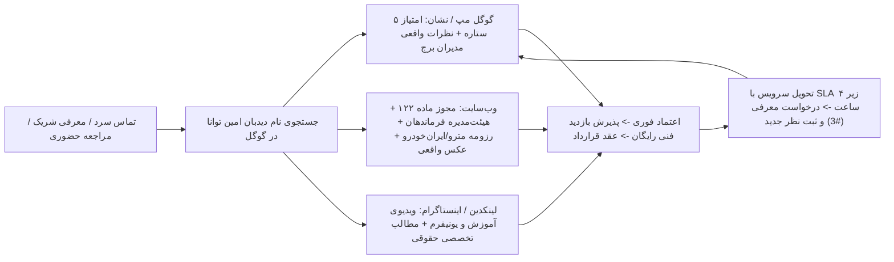

# نقشه راه جامع رشد فروش B2B و اعتبارسازی برند (Sales & Reputation Playbook)
## مؤسسه حفاظتی و مراقبتی دیدبان امین توانا (مجوز ماده ۱۲۲ فراجا)

> **هدف این سند:** تبدیل ۱۵ کانال جذب مشتری به یک **سیستم عملیاتی متعادل (فروش سریع + اعتبار ماندگار برند)** برای ۹۰ روز آینده، با تکیه بر مزیت‌های واقعی مؤسسه (رزومه رسمی، مجوز ماده ۱۲۲، هیئت‌مدیره فرماندهان بازنشسته فراجا و ارتش، وکیل پایه یک، و پروژه‌های شاخص).
> **بسته اسکریپت‌ها و پیام‌های آماده اجرا:** [`docs/sales-scripts-and-outreach-kit.md`](./sales-scripts-and-outreach-kit.md)

---

## ۱. مزیت ناعادلانه و اهرم اعتبار دیدبان امین توانا (Reputation Moat)

در بازار خدمات حفاظتی و لابی‌منی، شرکت‌ها روی «قیمت» رقابت می‌کنند؛ اما کارفرمایان حرفه‌ای (هیئت‌مدیره برج‌ها، مدیران کارخانه‌ها، سازندگان و مدیران حراست) روی **«کاهش ریسک حقوقی، امنیتی و آبرویی»** تصمیم می‌گیرند. در تمام ۱۵ کانال زیر، باید این ۵ اهرم واقعی (برگرفته از `docs/dideban_amin_tavana_company_resume.md`) را به جای معرفی عمومی استفاده کنید:

1. **اصالت قانونی قابل استعلام:** شماره ثبت `۵۵۳۵۶`، شناسه ملی `۱۴۰۱۲۱۰۷۸۱۷` (قابل استعلام آنی در رسمیو) و مجوز رسمی **مرکز انتظام پلیس پیشگیری فراجا (ماده ۱۲۲)** + انطباق با پیوست حفاظتی مبحث ۴ مقررات ملی ساختمان.
2. **مرجعیت فرماندهی و علمی هیئت‌مدیره:** حضور سه فرمانده ارشد بازنشسته (**سرهنگ قربانی** با سابقه ریاست کلانتری و مشاور حفاظت خط ۵ مترو، **سرهنگ ملکوتی‌خواه** با ۲۳ سال فرماندهی حفاظت و تشریفات ستاد مشترک ارتش و مدرک مدیریت هتل و تشریفات، و **دکتر مهدی ترکمن** دکتری جرم‌یابی و استاد دانشگاه علوم انتظامی امین و دافوس).
3. **پشتوانه قضایی اختصاصی:** بهره‌مندی از **وکیل پایه یک دادگستری** جهت حذف دغدغه دعاوی اداره کار، ماده ۶۶ تأمین اجتماعی، سلب حق سکونت سرایداری و پیگیری پرونده‌های کیفری.
4. **آکادمی آموزش مجوزدار:** استقرار نیرو صرفاً پس از گذراندن دوره و دریافت **«کارنامه کفایت آموزش»** با مجوز مرکز انتظام (به همراه تجربه آموزش تخصصی برای مجموعه‌هایی مثل **فولاد یزد** و **مترو**).
5. **کارنامه اجرایی تراز اول (Social Proof):** خط ۵ مترو تهران-کرج، نیروگاه برق قائم، کارخانه آذین تنه (گروه ایران‌خودرو)، مجتمع آب و آتش، مشاوره نیایش مال، و برج‌های گل نرگس، باران، مروارید غرب، حسابرسان، نسیم و چناران.

> **پیشنهاد طلایی (Trojan Horse) برای تمام کانال‌های B2B:**
> به جای گفتن «ما شرکت نگهبانی هستیم، نیرو می‌خواهید؟»، پیشنهاد **«بازدید فنی و ممیزی رایگان نقاط کور و ریسک حقوقی (ماده ۶۶ و مبحث ۴) توسط کارشناس ارشد و فرمانده بازنشسته انتظامی»** را بدهید. این پیشنهاد مقاومت کارفرما را به حداقل می‌رساند و بلافاصله جایگاه شما را از «پیمانکار معمولی» به «مشاور امین امنیتی» ارتقا می‌دهد.

---

## ۲. ماتریس کامل ۱۵ کانال جذب مشتری و اعتبارسازی

| اولویت | موج اجرا | روش جذب مشتری | نحوه اجرای دقیق | اهرم اعتبار دیدبان (Reputation Wedge) | هزینه تقریبی | زمان نتیجه‌دهی | احتمال تبدیل | مزایا / معایب |
| :---: | :---: | :--- | :--- | :--- | :--- | :--- | :---: | :--- |
| **۱** | موج ۱ | **همکاری با شرکت‌های مدیریت و نگهداری ساختمان** | عقد تفاهم‌نامه پورسانت یا معرفی متقابل با شرکت‌های نظافتی، آسانسور و تأسیسات برج‌ها | «پکیج کامل ساختمان بدون ریسک اداره کار + تعهد جایگزینی زیر ۴ ساعت که اعتبار خود شریک را حفظ می‌کند» | صفر (پورسانت پس از قرارداد) | ۲ تا ۴ هفته | بسیار بالا (۲۵–۳۵٪) | مزایا: اعتماد آماده، هزینه اولیه صفر / معایب: وابستگی به کیفیت شریک |
| **۲** | موج ۱ | **مراجعه حضوری هدفمند (Field Sales)** | مراجعه کارشناس فروش با کاتالوگ چاپی QRدار و کارت ویزیت به برج‌های نوساز (مناطق ۱ تا ۵ و ۲۲ تهران) و شهرک‌های صنعتی | دعوت به بازدید فنی رایگان + نمایش رزومه برج‌های گل نرگس/باران/مروارید غرب و QR استعلام رسمیو | کم (ایاب ذهاب + چاپ کاتالوگ) | ۱ تا ۳ هفته | بالا (۱۵–۲۵٪) | مزایا: مشاهده مستقیم نیاز (اتاق نگهبانی خالی) / معایب: زمان‌بر بودن تردد |
| **۳** | موج ۱ | **سیستم معرفی مشتری توسط مشتریان فعلی** | ارائه تخفیف ۱ ماه حق مدیریت یا بن خدمات رایگان به مدیران ساختمان فعلی بابت معرفی هر ساختمان جدید + درخواست ثبت نظر در گوگل‌مپ و نشان | تبدیل مشتریان راضی فعلی به سفیران برند + تولید نظرات واقعی روی نقشه برای اعتبارسنجی لیدهای جدید | کم (کسر از سود ماه اول) | فوری تا ۳ هفته | بسیار بالا (۳۰–۴۰٪) | مزایا: بالاترین نرخ تبدیل و اعتماد / معایب: مقیاس‌پذیری محدود به تعداد فعلی |
| **۴** | موج ۲ | **همکاری با شرکت‌های پیمانکاری و سازندگان** | ارتباط با پیمانکاران اسکلت، گودبرداری و انبوه‌سازان برای تأمین نگهبان کارگاه از روز اول تا تحویل پروژه (و تبدیل به قرارداد دائمی برج) | پوشش کامل بیمه حوادث (رفع ریسک ماده ۶۶ کارگاه) + سرکشی بازرس موتوری نیمه‌شب | بسیار کم | ۲ تا ۴ هفته | بالا (۲۰٪) | مزایا: تبدیل نگهبانی موقت کارگاه به قرارداد دائمی برج / معایب: شرایط سخت محیط کارگاهی |
| **۵** | موج ۲ | **بازاریابی تلفنی سرد (Cold Calling) با لیست تفکیک‌شده** | تماس روزانه ۳۰ تا ۴۰ شماره هدفمند با مدیران اداری/حراست کارخانه‌ها و انبارها با اسکریپت حل مشکل بیمه، سرقت و جایگزینی | قلاب کارخانه آذین تنه (ایران‌خودرو) + گشت RFID + پیشنهاد ممیزی رایگان نقاط کور | بسیار کم (حقوق ثابت + پورسانت) | ۲ تا ۶ هفته | متوسط (۵–۱۰٪) | مزایا: دسترسی سریع به حجم بالای سرنخ / معایب: نرخ رد شدن بالا در تماس اول |
| **۶** | موج ۲ | **همکاری با مشاوران املاک و دپارتمان‌های برج‌سازی** | ارائه پورسانت معرفی به مشاوران املاک لوکس و مدیران فروش پروژه‌های مسکونی و اداری نوساز | لابی‌من تشریفاتی آموزش‌دیده تحت نظر سرهنگ ملکوتی‌خواه (دارای مدرک مدیریت هتل و تشریفات) برای حفظ پرستیژ فروش برج | صفر (درصدی از قرارداد) | ۳ تا ۶ هفته | بالا (۲۰٪) | مزایا: دسترسی به پروژه‌ها قبل از استقرار رقیب / معایب: نیاز به پیگیری مداوم |
| **۷** | موج ۱ | **شکار فرصت‌های استخدامی (جابینجا / ای‌استخدام / دیوار)** | رصد روزانه شرکت‌هایی که آگهی «استخدام نگهبان» یا «لابی‌من» گذاشته‌اند و تماس با واحد HR برای پیشنهاد برون‌سپاری بدون دردسر بیمه و جایگزینی | ارسال آنی «مقایسه هزینه واقعی استخدام مستقیم vs برون‌سپاری ماده ۱۲۲» + جایگزینی زیر ۴ ساعت | رایگان | ۱ تا ۳ هفته | بالا (۱۵–۲۰٪) | مزایا: نیاز ۱۰۰٪ تأییدشده و فوری / معایب: رقابت با استخدام مستقیم |
| **۸** | موج ۳ | **تأمین نیرو از طریق مناقصات و استعلام بها** | ثبت‌نام و پایش روزانه سامانه ستاد ایران و پایگاه‌هایی مثل ایران‌تندر و پارس‌نماد | امتیاز فنی فوق‌العاده به پشتوانه رزومه مترو، نیروگاه قائم، مجوز ماده ۱۲۲ و آکادمی آموزش رسمی | متوسط (اشتراک + ضمانت‌نامه) | ۲ تا ۴ ماه | متوسط (۱۰–۱۵٪) | مزایا: قراردادهای بزرگ (۱۰ تا ۵۰ نیرو) / معایب: دوره پرداخت طولانی و نیاز به نقدینگی |
| **۹** | موج ۲ | **ساخت بانک اطلاعاتی و ایمیل/واتساپ B2B هدفمند** | استخراج اطلاعات کارخانه‌ها از سایت‌های رسمی و ارسال کاتالوگ PDF تعاملی + چک‌لیست ممیزی رایگان امنیتی | ارسال کاتالوگ رسمی + لینک برآوردگر آنلاین سایت + فایل چک‌لیست حقوقی ماده ۶۶ | کم (اشتراک پلتفرم داده) | ۳ تا ۶ هفته | متوسط (۵–۸٪) | مزایا: مقیاس‌پذیری بالا / معایب: نیاز به پیگیری تلفنی مکمل |
| **۱۰** | موج ۳ | **تبلیغات گوگل (Google Ads) روی کلمات نیت خرید** | اجرای کمپین جستجو روی کلماتی مثل «شرکت نگهبانی مجوزدار»، «استخدام لابی‌من برای برج»، «تأمین نیروی حراست» | فرود مستقیم روی صفحات تخصصی خدمات سایت با برآوردگر شیفت، واتساپ فعال و تماس زیر ۱۵ دقیقه | متوسط تا بالا | ۱ تا ۲ هفته | بالا (۱۰–۱۵٪) | مزایا: جذب مشتری با نیت خرید فوری / معایب: هزینه کلیک نسبتاً بالا |
| **۱۱** | موج ۱ (تأسیس) تا موج ۳ | **سئوی محلی و ثبت در گوگل مپ و نشان/بلد** | بهینه‌سازی پروفایل کسب‌وکار در نقشه ها، جمع‌آوری نظرات مشتریان و ساخت صفحات فرود شهرک‌های صنعتی و مناطق پرتقاضا | عکس واقعی یونیفرم‌ها، نشانی رسمی دفتر پونک، پاسخ حرفه‌ای به نظرات، و لینک مستقیم به صفحات خدمات | کم تا متوسط | ۳ تا ۶ ماه | بالا (بلندمدت) | مزایا: سرنخ رایگان و پایدار + اعتبار در جستجوی نام برند / معایب: زمان‌بر بودن نتیجه‌گیری |
| **۱۲** | موج ۲ تا ۳ | **ارتباط مستقیم با مدیران HR و حراست در لینکدین** | ارسال پیام‌های تخصصی غیرتبلیغاتی + انتشار محتوای مرجعیت علمی/حقوقی تحت نام مدیران مؤسسه | انتشار چک‌لیست‌های تخصصی با امضای کمیته علمی (دکتر ترکمن) و وکیل مؤسسه | رایگان (یا هزینه ادمین) | ۱ تا ۳ ماه | متوسط (۸–۱۲٪) | مزایا: دسترسی مستقیم به تصمیم‌گیرندگان شرکت‌های بزرگ / معایب: پاسخ‌دهی کندتر |
| **۱۳** | موج ۲ | **همکاری با فروشندگان دوربین مداربسته و گیت کنترل تردد** | همکاری با نصاب‌های سیستم‌های نظارتی برای ارائه پکیج کامل «تجهیزات + نیروی انسانی پایش و نگهبانی» | آموزش‌دیدگی نیروها در کار با اتاق مانیتورینگ و گشت RFID (نصاب فقط سخت‌افزار می‌فروشد، شما اپراتور حرفه‌ای می‌دهید) | صفر (پورسانتی) | ۳ تا ۶ هفته | متوسط-بالا | مزایا: مشتریان دغدغه‌مند امنیت / معایب: نیاز به هماهنگی فنی |
| **۱۴** | موج ۳ | **حضور و شبکه‌سازی در نمایشگاه‌های صنعت ساختمان و لجستیک** | بازدید هدفمند از غرفه‌های سازندگان، مدیران کارخانه و پیمانکاران در نمایشگاه بین‌المللی تهران (بدون نیاز به اجاره غرفه گران) | ارائه کارت ویزیت دارای QR کد رزومه دیجیتال + دعوت به بازدید رایگان کارگاه/کارخانه پس از نمایشگاه | بسیار کم | ۱ تا ۲ ماه | متوسط | مزایا: جمع‌آوری ده‌ها کارت ویزیت مدیران اصلی / معایب: فصلی بودن |
| **۱۵** | موج ۳ | **بازاریابی در شبکه‌های اجتماعی (اینستاگرام و کانال‌های تخصصی)** | انتشار ویدیوهای کوتاه از آموزش نیروها، لباس فرم استاندارد، گزارش‌دهی دیجیتال و مانورهای آمادگی | ویترین اعتبارسنجی (Social Proof) هنگام بررسی مشتری پس از تماس یا جلسه حضوری | کم تا متوسط | ۳ تا ۶ ماه | پایین-متوسط (B2B) | مزایا: اعتبارسنجی دیداری قوی / معایب: کانال اصلی جذب سازمانی نیست |

---

## ۳. نقشه اجرایی متعادل ۹۰ روزه (فروش سریع + اعتبار برند)

برای جلوگیری از پراکندگی، به جای اجرای هم‌زمان هر ۱۵ کانال، کار را در **۳ موج متوالی** پیش ببرید:

### 🟢 موج اول — روز ۱ تا ۳۰: قراردادهای سریع (هزینه نزدیک به صفر) + زیرساخت اعتبارسنجی
**هدف عددی ماه اول:** ۲ تا ۴ قرارداد جدید (یا ۶ تا ۱۰ بازدید فنی رایگان) + آماده شدن ویترین دیجیتال جهت اعتبارسنجی.

1. **آماده‌سازی «ویترین اعتبار» در هفته اول (پشتوانه همه تماس‌ها):**
   - فعال‌سازی شماره واتساپ رسمی در `config.js` (حیاتی برای تبدیل لیدهای تماس سرد، کاتالوگ و سایت).
   - ثبت و تکمیل پروفایل رسمی دفتر مرکزی (پونک شمالی، مجتمع غدیر) در **گوگل مپ، نشان و بلد** همراه با عکس‌های واقعی یونیفرم و دفتر (پیش‌نیاز کانال #۱۱).
   - آماده‌سازی یک **فایل PDF ۵ صفحه‌ای رسمی** (خلاصه `dideban_amin_tavana_company_resume.md` + لینک رسمیو + QR سایت) برای ارسال فوری در واتساپ.
   - اضافه کردن کد QR سایت (مستقیم به صفحه برآوردگر/خدمات) روی کاتالوگ چاپی و کارت ویزیت (پل آفلاین به آنلاین).
2. **اجرای کانال #۳ (معرفی مشتریان فعلی + جمع‌آوری نظر):**
   - تماس شخصی با مدیران برج‌ها و پروژه‌های فعلی/قبلی (مثل گل نرگس، باران، مروارید غرب، سپیدان رز و...)؛ ارائه طرح «۱ ماه تخفیف حق مدیریت بابت هر معرفی منجر به قرارداد» + درخواست ثبت یک نظر واقعی در گوگل‌مپ و نشان.
3. **اجرای روزانه کانال #۷ (شکار فرصت‌های استخدامی):**
   - هر روز صبح (۳۰ دقیقه): استخراج ۱۰ آگهی جدید «استخدام نگهبان / لابی‌من» در تهران و کرج از دیوار، جابینجا و ای‌استخدام -> تماس تلفنی + ارسال فایل مقایسه هزینه و رزومه در واتساپ.
4. **اجرای کانال #۱ (شراکت با شرکت‌های نگهداری ساختمان):**
   - لیست‌برداری از ۳۰ شرکت معتبر خدمات آسانسور، تأسیسات موتورخانه و نظافت برج‌های مناطق ۱ تا ۵ و ۲۲ -> برگزاری ۶ تا ۱۰ جلسه معارفه و عقد تفاهم‌نامه پورسانت.
5. **اجرای کانال #۲ (مراجعه حضوری هدفمند — ۲ روز در هفته):**
   - بازدید میدانی از برج‌های در حال تحویل در مناطق ۲، ۳، ۵ و ۲۲ (چیتگر، سعادت‌آباد، پونک، الهیه) و ثبت اطلاعات مدیر ساختمان/پیمانکار جهت پیگیری ۳ مرحله‌ای.

---

### 🟡 موج دوم — روز ۳۱ تا ۶۰: توسعه شبکه شرکای تجاری + خروجی سیستماتیک B2B
**هدف عددی ماه دوم:** عقد ۱۰ تفاهم‌نامه شراکت فعال + ۱۵ بازدید فنی جدید + آغاز حضور مرجع در لینکدین.

1. **گسترش کانال‌های شراکتی (#۴ سازندگان، #۶ املاک لوکس، #۱۳ نصاب‌های دوربین مداربسته):**
   - هدف‌گذاری ۲ شرکت نصاب دوربین/گیت کنترل تردد + ۵ دپارتمان املاک برج‌سازی + ۵ پیمانکار اسکلت/ساختمان در هفته.
   - ارائه پیشنهاد پکیج مشترک به نصاب‌ها: *«دوربین از شما، لابی‌من و اپراتور مانیتورینگ مجوزدار از ما»*.
2. **سیستم‌سازی کانال #۵ و #۹ (بانک اطلاعاتی شهرک‌های صنعتی + تماس سرد + واتساپ B2B):**
   - تهیه بانک اطلاعاتی ۳۰۰ کارخانه و انبار در **شمس‌آباد، سیمین‌دشت، چهاردانگه، جاده مخصوص و فتح**.
   - اجرای قانون **۳۰ تماس هدفمند در روز** + ارسال کاتالوگ PDF و چک‌لیست حقوقی ماده ۶۶ به علاقه‌مندان + پیگیری ۷ روزه.
3. **شروع موتور اعتبار در لینکدین (#۱۲):**
   - بهینه‌سازی صفحه شرکتی دیدبان امین توانا و پروفایل مدیرعامل/مدیر فروش.
   - انتشار هفته‌ای ۲ پست تخصصی (ریسک ماده ۶۶، پیوست مبحث ۴، مقایسه شیفت‌های ۱۴۰۵، گزارش کار گشت RFID) + ارسال روزانه ۱۰ پیام تخصصی غیرتبلیغاتی به مدیران HR و HSE کارخانه‌ها.
4. **به‌روزرسانی سایت متناسب با رشد فروش:**
   - افزودن عکس‌های واقعی پرسنل (`src/images/optimized/`) و بخش کارنامه پروژه‌های شاخص و هیئت‌مدیره.
   - اضافه کردن صفحه اختصاصی **همکاری و نمایندگی معرفی (Partners)** برای شرکای کانال‌های #۱، #۴، #۶ و #۱۳.

---

### 🔵 موج سوم — روز ۶۱ تا ۹۰+: قله اعتبار برند، مناقصات بزرگ و لیدهای ورودی پایدار
**هدف عددی ماه سوم:** ورود به مناقصات ۵+ نیرو، راه‌اندازی ورودی ارگانیک/پولی قابل اندازه‌گیری و تثبیت جایگاه برند در جستجو.

1. **کانال #۸ (مناقصات و سامانه ستاد ایران):**
   - تکمیل مدارک فنی، رتبه‌بندی و اسناد مالی برای ورود هدفمند به مناقصات ۵ تا ۳۰ نیرویی (با انتخاب کارفرمایان خوش‌حساب جهت مدیریت نقدینگی).
2. **کانال #۱۱ (توسعه صفحات سئوی محلی و صنعتی):**
   - انتشار صفحات فرود اختصاصی برای شهرک‌های صنعتی (شمس‌آباد، سیمین‌دشت، چهاردانگه) و برج‌های شمال/غرب تهران (سعادت‌آباد، منطقه ۲۲) مطابق `docs/strategic-growth-and-seo-plan.md`.
3. **کانال #۱۰ (Google Ads با بودجه کنترل‌شده روی کلمات نیت خرید):**
   - تنها پس از اتصال کامل GTM/GA4 و پیامک هشدار آنی لید (`api/lead.php`)؛ تست کمپین روی کلمات با نیت خرید فوری (*شرکت نگهبانی مجوزدار، استخدام لابی‌من برج، تأمین نگهبان کارخانه*).
4. **کانال #۱۵ (ویدیوهای کوتاه اعتبارسنجی) و #۱۴ (نمایشگاه‌ها):**
   - ضبط ۶ ویدیوی کوتاه ۳۰ تا ۴۵ ثانیه‌ای واقعی (کلاس آموزش آکادمی، تحویل شیفت منظم، اسکن تگ RFID شبانه، معرفی کوتاه سرهنگ قربانی/ملکوتی‌خواه) برای انتشار در اینستاگرام، لینکدین و سایت (به عنوان ابزار اثبات اعتبار، نه صرفاً جذب فالوور).
   - برنامه‌ریزی حضور هدفمند (بازدید غرفه‌ها بدون اجاره غرفه) در نمایشگاه صنعت ساختمان و لجستیک تهران.

---

## ۴. چرخه اعتبارسازی (Reputation Flywheel) — پل آفلاین به آنلاین

هر لید B2B پیش از امضای قرارداد، نام **«دیدبان امین توانا»** را در گوگل جستجو می‌کند. این ۵ نقطه تماس باید یکپارچه و بی‌نقص باشند:

### چک‌لیست ۵ اقدام فوری برای تکمیل حلقه اعتبار (پیش از هزینه تبلیغات):
- [ ] درج شماره واتساپ رسمی در `config.js` تا تمام دکمه‌های گفتگوی سریع سایت فعال شوند.
- [ ] تایید نهایی و جایگزینی نام‌های نمونه در `reviews` فایل `config.js` با پروژه‌ها/نظرات تاییدشده واقعی.
- [ ] اتصال هشدار پیامکی/ایمیلی `api/lead.php` جهت تماس با هر لید زیر ۱۵ دقیقه.
- [ ] ثبت دفتر پونک در گوگل مپ، نشان و بلد و دریافت حداقل **۱۰ نظر واقعی اول** از مشتریان و همکاران.
- [ ] آماده‌سازی کاتالوگ PDF رسمی (۵ صفحه‌ای) با لینک مستقیم به سامانه رسمیو (`14012107817`) و کد QR صفحه برآوردگر سایت.

---

## ۵. کارنامه هفتگی پیگیری (Weekly Sales & Reputation Scorecard)

هر پنج‌شنبه این جدول را در ۱۵ دقیقه بررسی کنید تا رشد فروش و اعتبار قابل اندازه‌گیری باشد:

| شاخص (KPI) | هدف هفتگی (موج ۱) | هدف هفتگی (موج ۲) | مسئول |
| :--- | :---: | :---: | :--- |
| تعداد آگهی‌های استخدامی رصد و تماس‌گرفته‌شده (#۷) | ۴۰ تماس | ۵۰ تماس | کارشناس فروش |
| تعداد بازدید میدانی برج/کارخانه جدید (#۲) | ۱۵ مورد | ۲۰ مورد | فروش میدانی |
| تعداد شرکت‌های شریک جدید مذاکره‌شده (#۱، #۴، #۶، #۱۳) | ۵ شرکت | ۸ شرکت | مدیر فروش / مدیرعامل |
| تعداد تماس سرد کارخانه‌ها و انبارها (#۵) | — | ۱۵۰ تماس | کارشناس فروش |
| تعداد **بازدید فنی رایگان** ست‌شده (مهم‌ترین شاخص میانی) | ۳ بازدید | ۶ بازدید | تیم فروش + کارشناس فنی |
| تعداد نظر واقعی جدید در گوگل‌مپ/نشان (#۳ و #۱۱) | ۲ نظر | ۲ نظر | امور مشتریان |
| تعداد پست مرجعیت لینکدین / ویدیوی کوتاه (#۱۲ و #۱۵) | ۱ محتوا | ۲ محتوا | ادمین / بازاریابی |
| نرخ پاسخگویی به لیدهای سایت و واتساپ زیر ۱۵ دقیقه | ۱۰۰٪ | ۱۰۰٪ | مدیر فروش |
