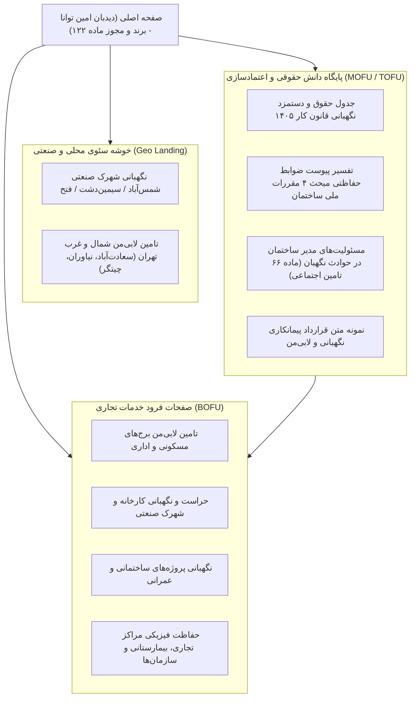

# سند استراتژی رشد دیجیتال، معماری سئو و افزایش قراردادهای B2B
## مؤسسه مراقبتی حفاظتی دیدبان امین توانا (مجوز ماده ۱۲۲ فراجا)

---

### ۱. تحلیل موقعیت و درک منطق فروش سازمانی (B2B Reality)

سایت شرکت «دیدبان امین توانا» فروشگاه اینترنتی نیست؛ بلکه **یک کانال لیدجنریشن (Lead Generation) و اعتمادسازی فوق تخصصی B2B** است. در این بازار، مخاطب شما (مدیر برج، مدیر کارخانه، مدیرعامل یا رئیس حراست) خریدار خرد نیست؛ بلکه به دنبال **کاهش ریسک‌های حقوقی، کیفری و مالی** است.

#### ماتریس دغدغه و محرک تصمیم‌گیری مشتریان هدف:
| پرسونای مخاطب | بزرگ‌ترین ترس و دغدغه (Pain Point) | قلاب متقاعدسازی دیدبان امین توانا | شاخص کلیدی تبدیل |
| :--- | :--- | :--- | :--- |
| **مدیران برج‌ها و هیئت‌مدیره** | دعوای تخلیه سرایداری، شکایات سنوات، پوشش نامناسب | لابی‌من تشریفاتی، سلب حق سکونت در مشاعات، بدون بار سنواتی | درخواست نمونه لباس فرم و بازدید رایگان |
| **مدیران کارخانه‌ها و شهرک‌های صنعتی** | سرقت شبانه مواد اولیه، تبانی در باسکول، خوابیدن نگهبان | گشت‌زنی ثبت‌شده با RFID، نظارت سرشیفت، فاکتور رسمی مالیاتی | برآوردگر شیفت + ارزیابی نقاط کور کارخانه |
| **سازندگان و پروژه‌های عمرانی** | سرقت کابل و ابزارآلات، دیه حوادث کارگاهی (ماده ۶۶) | پوشش کامل بیمه حوادث و مسئولیت، استقرار ۲۴ الی ۴۸ ساعته | استعلام سریع استقرار و بیمه‌نامه |
| **مدیران منابع انسانی / حراست** | تخلف پرسنلی، گزینش ناکافی، بار اداری بیمه و حقوق | گزینش ۵ مرحله‌ای پلیس پیشگیری فراجا، تعهد جایگزینی < ۴ ساعت | دریافت چک‌لیست ۱۰ نکته حقوقی + کاتالوگ |

---

### ۲. فاز اول: ارتقای زیرساخت فنی و پرفورمنس (Technical Foundation)

صفحه فرود فعلی شما در پوشه `dideban-amin-tavana` دارای کپی‌رایتینگ و المان‌های بصری مناسبی است؛ اما برای ورود به بازار رقابتی و فتح سئو به اصلاحات فنی زیر نیاز دارد:

1. **انتقال از CDN به بیلد بهینه (Production Asset Build):**
   - حذف کامل `<script src="https://cdn.tailwindcss.com/3.4.17"></script>` که سرعت لود را به شدت کند کرده و در گوگل لایت‌هاوس امتیاز منفی می‌گیرد.
   - تولید فایل CSS کامپایل و فشرده‌شده (Purged & Minified CSS زیر ۴۰ کیلوبایت).
2. **تبدیل لندینگ تک‌صفحه‌ای به ساختار چندصفحه‌ای چندمنظوره (Multi-page SSG / SSR):**
   - موتورهای جستجو نمی‌توانند یک تک‌صفحه (Single Page) را هم‌زمان در ۲۰ عبارت کلیدی متفاوت رتبه دهند. هر سرویس و هر لوکیشن باید صفحه مستقل خود را داشته باشد.
3. **اتصال فرم‌ها و برآوردگر به پایگاه ثبت لید (Instant Lead CRM / Webhook):**
   - اتصال فرم برآوردگر و درخواست بازدید به وب‌سرویس پیامکی (ارسال آنی پیامک هشدار به مدیر فروش و ارسال پیامک خوش‌آمد به مشتری).
   - انتقال خودکار اطلاعات به Google Sheets یا نرم‌افزار CRM جهت تماس کارشناس در کمتر از ۱۵ دقیقه.
4. **پیاده‌سازی ره‌گیری پیشرفته رویدادها (Google Tag Manager & GA4):**
   - ردیابی کلیک روی دکمه‌های واتساپ (`click_whatsapp`)
   - ردیابی کلیک روی شماره تلفن تماس مستقیم (`click_call`)
   - ردیابی تکمیل فرم برآوردگر شیفت (`generate_lead_estimator`)
   - ردیابی ثبت فرم بازدید رایگان (`request_free_inspection`)

---

### ۳. فاز دوم: ساختار و معماری سئو (SEO Silo Architecture & Content Clusters)

برای تسخیر جایگاه‌های صفحه اول گوگل، وب‌سایت باید بر اساس معماری خوشه‌ای (Topic Clusters) به چهار لایه اصلی تقسیم شود:



#### ۱. خوشه صفحات خدمات تخصصی (Commercial / Transactional Intent):
این صفحات هدف نهایی جذب ترافیک با هدف استعلام و قرارداد هستند:
- `/services/lobby-man-residential-towers`:
  - کلمات کلیدی هدف: *استخدام لابی من برج، تامین لابی من شیفتی، شرکت لابی من مسکونی، وظایف لابی من برج لاکچری*
- `/services/industrial-plant-security`:
  - کلمات کلیدی هدف: *تامین نگهبان کارخانه، حراست شهرک صنعتی، شرکت انتظامات انبار، حفاظت فیزیکی کارخانجات تهران*
- `/services/construction-site-guarding`:
  - کلمات کلیدی هدف: *نگهبان کارگاه ساختمانی، حفاظت پروژه عمرانی، جلوگیری از سرقت مصالح ساختمانی*
- `/services/armed-escort-event-security`:
  - کلمات کلیدی هدف: *حفاظت اماکن و همایش‌ها، نگهبان تشریفاتی نمایشگاه*

#### ۲. خوشه صفحات جغرافیایی و شهرک‌های صنعتی (Local & Industrial SEO):
- صفحات اختصاصی قطب‌های صنعتی:
  - *خدمات نگهبانی و حراست در شهرک صنعتی شمس‌آباد*
  - *تامین نیروی انتظامات در شهرک صنعتی چهاردانگه و عباس‌آباد*
  - *حراست کارخانجات سیمین‌دشت و جاده مخصوص کرج*
- صفحات مناطق برج‌نشین تهران:
  - *تامین لابی‌من مجتمع‌های سعادت‌آباد و شهرک غرب*
  - *نگهبانی و حراست برج‌های منطقه ۲۲ و چیتگر*

#### ۳. خوشه مقالات تخصصی و مگنت‌های حقوقی (Inbound Lead Generation):
این صفحات ترافیک تصمیم‌گیرندگان را پیش از خرید صید می‌کنند:
- *راهنمای کامل محاسبه شیفت نگهبانی ۲۴-۴۸ و ۱۲-۱۲ بر اساس قانون کار ۱۴۰۵*
- *پیوست مبحث چهارم مقررات ملی ساختمان؛ استانداردهای الزامی اتاق نگهبانی*
- *خطرات پنهان استخدام نگهبان افغانستانی یا اتباع بدون مجوز برای مدیران پروژه*
- *آیا مدیر ساختمان مسئول فوت یا نقص عضو نگهبان در شیفت شب است؟ (بررسی ماده ۶۶)*

---

### ۴. اسکیماها و داده‌های ساختاریافته (Technical Schema & Knowledge Graph)

برای ایجاد تمایز دیداری در نتایج گوگل (Rich Snippets) و اثبات اعتبار حقوقی:
1. **اسکیمای سازمان و کسب‌وکار محلی (`LocalBusiness` / `SecurityService`):**
   - درج شناسه ملی (`taxID`: 14012107817) و شماره ثبت (`identifier`: 55356).
   - تصریح به حوزه جغرافیایی تحت پوشش (`areaServed`: تهران، البرز و حومه).
2. **اسکیمای سوالات متداول (`FAQPage`):**
   - درج پرسش‌های پرتکرار پیرامون نرخ قانون کار ۱۴۰۵، تعهد جبران خسارت و زمان جایگزینی در سرپ گوگل.
3. **اسکیمای مقالات تخصصی (`Article` / `HowTo`):**
   - برای مقالات آموزشی حقوقی و چک‌لیست قرارداد.
4. **اسکیمای خدمات (`Service`):**
   - قیمت‌گذاری شفاف و مشخصات SLA برای هر خدمت.

---

### ۵. فاز سوم: مهندسی نرخ تبدیل (CRO) و قیف فروش قراردادها

برای اینکه بازدیدهای سایت واقعاً به **جلسه حضوری و عقد قرارداد** تبدیل شوند، مسیر زیر طراحی می‌شود:

```
[بازدیدکننده هدفمند]
       │
       ▼
[شناسایی درد و تفکیک پرسنلی در صفحه اول] (مدیر برج / مدیر کارخانه / سازنده)
       │
       ▼
[تست برآوردگر آنلاین و محاسبه شفاف هزینه‌های ۱۴۰۵]
       │
       ▼
[ارائه پیشنهاد مقاومت‌ناپذیر (Lead Magnet)]:
"دانلود رایگان چک‌لیست ۱۰ نکته حقوقی + استعلام پیش‌فاکتور رسمی"
       │
       ▼
[دریافت شماره موبایل مدیر یا تماس مستقیم واتساپ]
       │
       ▼
[پاسخگویی سریع ظرف ۱۵ دقیقه + رزرو بازدید فنی رایگان از محل]
       │
       ▼
[حضور کارشناس در محل، ممیزی نقاط کور، ارائه پیش‌فاکتور رسمی و عقد قرارداد]
```

#### اهرم‌های کلیدی افزایش نرخ تبدیل در سایت:
1. **ضمانت جایگزینی قطعی (SLA):** برجسته‌سازی تعهد کتبی «جایگزینی کمتر از ۴ ساعت» و «تعویض بی‌قیدوشرط نیرو ظرف ۴۸ ساعت».
2. **اثبات اعتبار و شفافیت مجوز (Trust Badges):**
   - واترمارک رسمی روی آگهی روزنامه رسمی و مجوز مرکز انتظام فراجا.
   - لینک مستقیم به سامانه رسمیو جهت استعلام برخط شناسه ملی ۱۴۰۱۲۱۰۷۸۱۷.
3. **CTAهای با اصطکاک پایین (Low-Friction CTAs):**
   - به جای «همین حالا قرارداد ببندید»، از **«درخواست بازدید فنی و ارزیابی رایگان نقاط کور»** استفاده شود؛ این پیشنهاد بدون هزینه بوده و کارفرما مقاومت کمتری در برابر آن دارد.

---

### ۶. نقشه راه عملیاتی سه‌ماهه (Implementation Roadmap)

| زمان‌بندی | اقدامات کلیدی | خروجی ملموس |
| :--- | :--- | :--- |
| **هفته ۱ تا ۲** | • برطرف کردن باگ‌های رندرینگ و حذف CDN تیل‌ویند<br>• راه‌اندازی هاست پرسرعت ابری داخلی (پارس‌پک، آروان یا دیتاسنترهای داخلی)<br>• راه‌اندازی ساختار چندصفحه‌ای برای ۳ سرویس اصلی | لود صفحه زیر ۱.۵ ثانیه و کسب Core Web Vitals سبز |
| **هفته ۳ تا ۴** | • پیاده‌سازی سورس اتصال فرم‌ها به پنل پیامکی و CRM<br>• ثبت و تایید مکان شرکت در گوگل مپ، نشان، بلد و اسنپ<br>• راه‌اندازی سرچ کنسول و گوگل آنالیتیکس ۴ | تکمیل زیرساخت لیدجنریشن و ثبت محلی کسب‌وکار |
| **ماه دوم** | • تولید و انتشار صفحات خدمات تخصصی (برج، کارخانه، کارگاه)<br>• انتشار ۳ مقاله کلیدی حقوقی و محاسباتی ۱۴۰۵<br>• پیاده‌سازی کامل اسکیماهای ساختاریافته | آغاز رتبه‌گیری در کلمات کلیدی طولانی (Long-tail) |
| **ماه سوم** | • توسعه صفحات سئوی صنعتی (شمس‌آباد، سیمین‌دشت و مناطق تهران)<br>• بهینه‌سازی کپی‌رایتینگ فرم‌ها بر اساس دیتای کاربران<br>• لینک‌سازی هدفمند در دایرکتوری‌های صنعتی و ساختمانی | افزایش ورودی ارگانیک، استعلام‌های تلفنی و ثبت بازدید |
